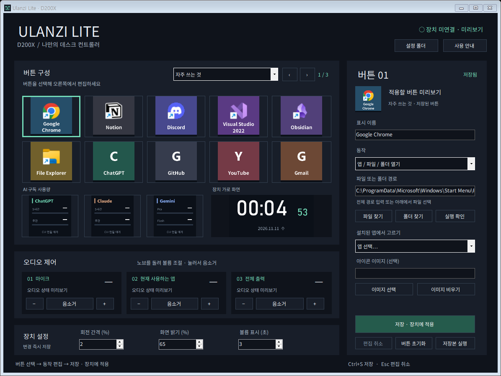

# Ulanzi Lite for D200X

**버튼은 바로 실행하고, 소리는 손끝에서.**
Ulanzi D200X를 위한 가벼운 Windows 컨트롤러입니다. 앱·사이트 실행, AI 구독 사용량 미터, 세 노브의 오디오 제어, 시계와 볼륨 표시를 하나의 실행 파일로 제공합니다.

Windows Forms · 기본 .NET Framework · Win32 HID · Windows Core Audio. 별도 런타임 설치, 웹 서버, 추가 드라이버가 필요하지 않습니다. Ulanzi와 제휴하지 않은 비공식 프로젝트이며 현재 버전은 **0.3.0 미리보기**입니다.



## 시작하기

Windows 10/11 x64, .NET Framework 4.5 이상이 필요합니다.

1. 실행 파일 또는 배포 ZIP을 **쓰기가 가능한 폴더**에 둡니다. ZIP은 먼저 압축을 풀어 주세요.
2. Ulanzi Studio를 트레이에서도 종료하고 D200X를 USB로 연결합니다.
3. 파일 탐색기에서 `UlanziLite.exe`를 실행합니다. 관리자 권한은 필요하지 않습니다.
4. 버튼을 선택해 동작을 편집하고 **저장 · 장치에 적용**을 누릅니다.

장치가 없어도 버튼 설정을 편집하고 저장할 수 있습니다. 연결되면 현재 페이지를 자동 적용합니다. 설치·자동 시작 등록은 하지 않습니다.

## 버튼 편집

기본 구성은 **편집 버튼 10개 × 3개 페이지 + 고정 사용량 미터 3개**입니다. 기기 측면 버튼과 창의 페이지 선택기로 이동합니다.

| 동작 | 입력 |
| --- | --- |
| 사이트 열기 | `https://` 또는 `http://` 주소 |
| 앱 / 파일 / 폴더 열기 | 실행 파일, 시작 메뉴 바로가기, 파일 또는 폴더의 전체 경로 |
| 빈 버튼 | 주소 또는 경로를 비운 상태 |

표시 이름은 40자까지 지원하고, PNG·JPG·BMP 아이콘을 선택할 수 있습니다. 이미지는 원본 경로를 참조하므로 파일을 유지해야 합니다. 기본 앱과 사이트는 변경 가능한 예시입니다.

- **실행 확인**: 현재 입력한 동작을 시험합니다. **저장본 실행**: 저장된 동작을 실행합니다.
- 편집 내용은 버튼 목록과 오른쪽 **미리보기**에 바로 표시됩니다. 장치에는 저장한 뒤 반영됩니다.
- 동작에 따라 주소·경로 안내와 파일 찾기 버튼이 바뀝니다. 저장할 수 없는 입력은 편집 영역에 이유를 표시하고 해당 입력으로 이동합니다.
- 버튼·페이지를 이동해도 편집 내용은 유지됩니다. **● 저장 전** 표시가 있는 내용은 아직 장치에 적용되지 않았습니다.
- **Ctrl+S**는 선택 버튼을 저장하고, **Esc** 또는 **편집 취소**는 선택 버튼의 편집을 취소합니다.
- **버튼 초기화**도 편집 상태로 남습니다. 저장하면 적용하고 Esc로 취소할 수 있습니다.
- 완전히 종료할 때 미저장 편집이 있으면 저장·버리기·취소를 선택합니다. 편집 초안은 메모리에만 있으므로 비정상 종료 시에는 복구되지 않습니다.

회전 간격·밝기·볼륨 표시 시간은 별도의 **장치 설정** 영역에 있으며 변경 즉시 저장합니다. 현재 페이지도 즉시 저장합니다. 창을 넓히면 버튼과 오디오 영역이 함께 확장되고, 작은 창에서는 스크롤로 전체 설정을 확인할 수 있습니다.

## AI 구독 사용량

하단 세 버튼은 **ChatGPT / Claude / Gemini**의 사용량 미터입니다. 클릭하거나 장치 버튼을 누르면 관련 사용량 화면을 엽니다. 기존 CLI 로그인을 자동으로 활용합니다.

- ChatGPT: `.codex` 세션 로그의 **Codex 5시간·주간** 사용률.
- Claude: `.claude` 로그인으로 계정의 **5시간·주간** 사용률 조회.
- Gemini: `.gemini` 로그인으로 **CLI Pro·Flash 할당량** 조회. 웹 구독 한도와 다를 수 있습니다.

막대는 **사용한 비율**이며, 알 수 없는 값은 `—`로 표시합니다. 연결·권한 오류와 오래된 정보는 따로 표시합니다. 기존 하단 버튼 설정은 삭제하지 않습니다.

[연동 방식·개인정보·상태 표시·진단 안내](docs/USAGE.md)

## 세 노브와 가로 화면

왼쪽부터 **마이크 / 현재 사용하는 앱 / 전체 출력**입니다. 시계 방향으로 볼륨 증가, 반시계 방향으로 감소, 누르면 음소거를 전환합니다. 회전해도 음소거는 유지합니다. 회전 간격은 기본 2%, 설정 범위는 1~10%입니다.

| 노브 | 조절 대상 |
| --- | --- |
| 마이크 | Windows 기본 **통신 입력 장치** |
| 현재 사용하는 앱 | 전면 앱과 같은 실행 파일 이름의 오디오 세션. 여러 출력 장치·인스턴스·브라우저 탭이 함께 조절될 수 있습니다. |
| 전체 출력 | Windows **기본 출력 장치** |

설정 창을 열면 마지막으로 선택한 다른 앱을 유지합니다. 앱의 오디오 세션이 없으면 대기로 표시하고 볼륨을 변경하지 않습니다.

가로 화면은 PC 시간으로 시계와 날짜를 표시합니다. 노브를 조작하면 세 볼륨·음소거 상태·조작 중인 노브를 보여주고, 마지막 조작부터 기본 3초 후 시계로 돌아갑니다. 표시 시간은 1~30초로 변경할 수 있습니다. 트레이에서도 장치 제어와 화면 갱신은 계속됩니다.

시계는 시·분을 크게, 초를 작게 표시합니다. 모든 장치 이미지의 하단 5%는 시야각을 위한 여백으로 비웁니다. 숫자는 Bahnschrift, 한글은 Noto Sans KR을 우선 사용하며, 미설치 시 각각 Segoe UI·맑은 고딕으로 대체합니다. 별도 글꼴 설치는 필수가 아닙니다.

창을 닫으면 트레이로 숨깁니다. 트레이 아이콘을 두 번 클릭하면 설정 창이 열리고, 우클릭 → **종료**로 완전히 종료합니다.

## 설정과 문제 해결

**설정 폴더** 버튼으로 데이터 위치를 열 수 있습니다. 모든 데이터는 실행 파일 옆에 저장합니다.

| 파일 | 용도 |
| --- | --- |
| `settings.json` | 저장된 버튼과 설정 |
| `settings.json.bak` | 마지막 저장 직전의 설정 |
| `ulanzi-lite.log` / `.log.old` | 현재 로그와 직전 로그. 약 512KiB에서 순환합니다. |

설정이 손상되었다면 앱을 종료하고 현재 `settings.json`을 별도 보관한 뒤 `settings.json.bak`을 복사해 `settings.json`으로 바꿉니다. 초기 상태로 시작하려면 설정 파일을 다른 이름으로 옮긴 뒤 다시 실행하세요. 앱은 손상된 설정을 임의로 덮어쓰지 않습니다.

| 증상 | 확인할 것 |
| --- | --- |
| 연결 대기 | Studio 완전 종료, USB 데이터 케이블·포트 확인. 2초마다 자동 재연결합니다. |
| 저장은 됐지만 장치 적용 실패 | 연결 상태 확인. 재연결 시 현재 저장된 페이지를 다시 보냅니다. |
| 현재 앱 볼륨이 대기 | 해당 앱에서 오디오를 재생하고 전면 창으로 선택합니다. |
| 다른 마이크·출력이 변함 | Windows의 기본 통신 입력/기본 출력 장치를 확인합니다. |
| 저장 실패 | 실행 폴더의 쓰기 권한과 설정·이미지 경로를 확인합니다. |
| 실행·현재 앱 감지가 제한됨 | 테스트용 격리 데스크톱 대신 파일 탐색기에서 직접 실행합니다. |

화면과 밝기를 기존 Studio 구성으로 복구하려면 Lite를 종료하고 Studio에서 원래 프로필을 적용하세요. 장치 펌웨어와 Studio 설정 파일은 변경하지 않습니다.

AI 미터는 기존 CLI 로그인 정보를 이용해 Claude·Google의 공식 서비스 서버에서 사용 한도를 조회합니다. Codex는 로컬 로그만 읽습니다. 토큰·대화 내용은 앱 설정이나 로그에 저장하지 않으며 원격 분석·음성 및 키보드 입력 수집은 없습니다. 사이트 버튼은 기본 브라우저를 엽니다. 로그와 진단에는 앱 이름·로컬 경로가 포함될 수 있으므로 이슈에 공유하기 전에 확인해 주세요.

## 개발과 검증

별도 패키지 설치 없이 Windows 기본 .NET Framework 컴파일러로 빌드합니다.

```powershell
.\build.ps1
.\test.ps1
.\package.ps1
```

자동 검증은 장치에 연결하지 않고 HID 프레이밍, 설정·백업, 이미지 묶음, 볼륨 표시 상태 전이와 편집 UI를 검사합니다. 실제 USB 입력·화면·오디오 동작은 하드웨어에서 별도로 확인해야 합니다. 모든 펌웨어와 환경에서의 동작을 보장하지 않습니다.

[검증·진단·배포 절차](docs/TESTING.md) · [기여 안내](CONTRIBUTING.md) · [프로토콜 메모](docs/PROTOCOL.md)

## 참고

USB 호환성 구현은 공개된 [edubox/opendeck-ulanzi-d200x](https://github.com/edubox/opendeck-ulanzi-d200x)의 프로토콜 정보를 참고했습니다. 호스트 코드는 독립 구현이며 해당 플러그인이나 Studio에 의존하지 않습니다. 오디오는 Windows Core Audio를 사용합니다.
